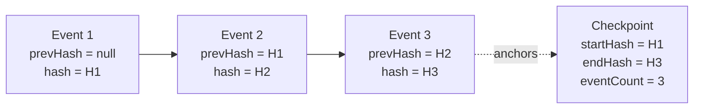

# Audit log design

Every sensitive action in BlakPath is **audit-logged**. The audit trail is
**append-only** and **tamper-evident**: rows are never updated or deleted, and a
SHA-256 hash chain makes any insertion, edit or removal detectable. This is what
lets an organisation trust that the record of who did what — including the
recording of human determinations — is intact.

Implementation: `src/db/schema/audit.ts` (`audit_events`,
`audit_integrity_checkpoints`, `break_glass_requests`).

## Event schema

Each row in `audit_events` captures one audited action:

| Field                        | Type           | Purpose                                                                                              |
| ---------------------------- | -------------- | ---------------------------------------------------------------------------------------------------- |
| `id`                         | uuidv7         | App-generated id (time-ordered; known before insert, needed for chaining).                           |
| `organisationId`             | uuid, nullable | Tenant owner. **Null = platform-level** event; set = tenant event. Indexed first.                    |
| `timestamp`                  | timestamptz    | When the action occurred.                                                                            |
| `actorUserId`                | uuid, nullable | Who acted; null for system/unauthenticated events.                                                   |
| `actingRole`                 | text           | The role the actor was acting under (audit attribution).                                             |
| `sessionId`                  | uuid, nullable | Session that performed the action.                                                                   |
| `action`                     | text           | What happened, e.g. `application.update`, `decision.record`, `auth.signin`.                          |
| `resourceType`               | text           | Kind of resource, e.g. `application`, `evidence`, `membership`.                                      |
| `resourceId`                 | text, nullable | The affected resource id.                                                                            |
| `result`                     | enum           | `success` \| `failure` \| `denied` (`audit_result`). `denied` = authz refusal; `failure` = error.    |
| `reason`                     | text, nullable | Coded value (`code` or `code:recordId`). Free text stays on the mutable row the id points at.        |
| `ipAddress`, `userAgent`     | text           | Request origin. `ipAddress` is the trusted client address, or null when the origin was not verified. |
| `correlationId`, `requestId` | text           | Trace/correlation, from the `TenantContext`.                                                         |
| `beforeMeta`, `afterMeta`    | jsonb          | **Minimal, non-sensitive** change context — never full evidence payloads or secrets.                 |
| `prevHash`                   | text, nullable | Hash of the previous event in this chain (null for the first).                                       |
| `hash`                       | text           | SHA-256 of this event's canonical content **plus** `prevHash`.                                       |

Attribution comes straight from the verified `TenantContext`
(`src/lib/tenancy/context.ts`): `organisationId`, `userId`, acting `roles`,
`sessionId`, `correlationId`, `requestId`, `ipAddress`, `userAgent`. This means
audit binding is tenant-scoped by construction (`docs/tenant-isolation.md`).

## SHA-256 hash chaining

Each event is linked to the previous one so the sequence cannot be silently
altered:

```text
hash(n) = SHA-256( canonical(event n fields)  ‖  prevHash(n) )
prevHash(n) = hash(n-1)      // null for the first event in the chain
```

- `canonical(...)` is a deterministic serialisation of the event's content
  fields (stable key order, normalised types) so the same event always hashes to
  the same value.
- Chains are **per scope**: a per-tenant chain (`organisation_id` set) and a
  platform chain (`organisation_id` null). Appends serialise per chain so
  `prevHash` is well-defined.
- `UNIQUE (organisation_id, prev_hash) NULLS NOT DISTINCT` allows one successor
  per predecessor, including one genesis row (`prev_hash` null) per chain.



Editing event 2 changes H2, which breaks the `prevHash` link stored on event 3 —
the mismatch pinpoints the tampering. Deleting a row breaks the count and the
chain link at that point.

## Integrity checkpoints & external anchors

The hash above is an unkeyed digest. Recomputing it over a rewritten chain
still matches the stored rows, and a checkpoint row in the same database can be
rewritten with them. Two records are kept:

- `audit_integrity_checkpoints` is an in-database note of a verified period
  (`organisationId`, `periodStart`, `periodEnd`, `eventCount`, `startHash`,
  `endHash`, `verifiedAt` / `verifiedBy`). It bounds the scheduled re-walk. It
  is not the trust root.
- Once a day the worker writes one **signed chain-head anchor** per chain
  (each active organisation, plus the platform chain) to the
  `S3_BUCKET_AUDIT_ANCHORS` bucket. The object is
  `audit-anchors/{chainId}/{yyyy-mm-dd}.json`. It commits to the head hash, the
  event count, and the hash of the previous anchor. Production puts use S3
  Object Lock **compliance** retention and a KMS signature
  (`AUDIT_ANCHOR_SIGNING_KEY_ID`). Local development signs with HMAC.

**Verification** reads the chain in keyset pages ordered by `(timestamp, id)`,
the same total order used when appending. Only one page is resident, so a
multi-million-event chain stays inside a fixed memory ceiling. Each `hash` is
recomputed and every `prevHash` must link to the previous event.

- The scheduled job resumes after the latest checkpoint for that chain instead
  of re-walking from genesis. It re-checks the checkpoint's tip (it must still
  exist and still recompute), then verifies only events strictly after it.
- It then compares the whole chain to every stored anchor without loading it:
  one count gives the absolute chain length through the verified tip, and one
  ranked query reads the stored hash at each anchored position. A shorter
  chain, or a chain whose hashes were recomputed, fails even when a forged
  checkpoint was appended for the rewritten tip.
- Only a run that passes both checks inserts the next checkpoint. A divergent
  or anchor-mismatched chain writes nothing, logs `signal=audit_integrity_failure`
  with `alert=true`, and publishes no replacement anchor. An unchanged tip keeps
  the existing checkpoint as the resume point (no zero-length checkpoint).
- `infra/aws/operational-alerts.example.yaml` turns that signal into the
  `AuditIntegrityFailures` metric and the `blakpath-audit-integrity-failure`
  alarm.
- Incremental runs do not recompute rows before the latest checkpoint. An
  in-place edit of an old row that leaves its stored `hash` untouched is caught
  only by a full walk: `verifyChain` still walks a full chain, or an explicit
  slice, for restore drills (`scripts/verify-restored-data.ts`).

Verification is not a permission. People with `audit:view` read the result in
the trail (`audit.chain_verified`, `audit.checkpoint_created`,
`audit.divergence_detected`).

The first anchor is the baseline. Take it before the organisation records
production decisions. Later anchors must stay monotonic and must link to the
previous day's anchor.

## Append-only guarantee

- **Application layer:** there is exactly one audit-write path (append). No
  service exposes UPDATE or DELETE for `audit_events`.
- **Roles:** `pnpm db:migrate` in production connects with
  `DATABASE_MIGRATION_URL` (the owning role, default name `blakpath_migrator`).
  The running app and worker connect with `DATABASE_URL` as `blakpath_app`.
  That role is granted `SELECT` and `INSERT` on `audit_events` and
  `audit_integrity_checkpoints`, and ordinary DML on other tables. The migrate
  job reads the owner URL from the `blakpath-migrator` secret, not from the
  runtime secret.
- **Triggers:** `BEFORE UPDATE`, `BEFORE DELETE` and `BEFORE TRUNCATE` triggers
  on both audit tables raise `42501`. They are `ENABLE ALWAYS`, so they also
  fire for the table owner. A superuser can still disable a trigger; the
  application role must not be that superuser, and must not own the tables.
- **Retention:** audit records are retained per policy and are **not** subject to
  ordinary record-deletion, because deleting them would defeat their purpose
  (`docs/privacy-architecture.md`). Any lawful expiry happens by whole,
  verified, archived periods — never by editing individual rows. The anchor
  bucket's compliance retention is the outside copy of each day's head.

## Redaction rules

The audit trail records _that_ something happened and _who_ did it, not the
sensitive content itself:

- `beforeMeta` / `afterMeta` carry **minimal** change context — changed field
  names, status transitions, ids — **never** full evidence payloads, personal
  identity documents, genealogy detail, passwords, TOTP secrets or tokens.
- Personal values are not stored. A rename is `changed: ['applicantName']`, not
  the name. An evidence upload records the application id, not the file name.
  Notes, emails, phone numbers and form answers are on the same denylist
  (`src/domains/audit/hash.ts`). A forbidden key is stored as `[REDACTED]` even
  if an allowlist names it, and tests fail if any allowlist names one.
- `reason` is a dotted code. When the explanation is free text, the code may
  be `code:recordId` and the text lives only on that mutable row (for example
  `application_status_history.note` or `break_glass_requests.denial_reason`).
- Secrets are never written to audit under any circumstance.
- Because the hash covers the content fields, redaction is done **at write time**
  (only safe metadata is ever stored); the stored row is not later scrubbed, so
  the chain stays intact. Retention anonymisation removes a name from the
  application row. It does not rewrite `audit_events`. That is safe only
  because new events never received the name.
- Reads of the audit trail are themselves permission-checked (`audit:view`) and
  tenant-scoped, so one tenant can never read another's audit history. The
  organisation id comes from the verified tenant context, never from the query.
  Opening the log (`audit.viewed`), exporting it (`audit.exported`) and
  acknowledging the monthly review (`audit.monthly_review_recorded`) are events
  on the same chain.

## Existing chains

The production-readiness review on 2026-10-13 (`main` @ `8e7dc3c`) found no
BlakPath database in the AWS account. There are no production audit rows to
remediate.

Do not `UPDATE` or `DELETE` `audit_events` to remove personal information.
Either change breaks the hash chain, and the append-only triggers above refuse
both. No migration disables those triggers to scrub old rows. A non-production database that already
contains names, notes or file names in the trail should be dropped and
recreated before it is used for production records. If a future production
chain is ever found to contain personal data, archive and verify that chain as
a whole, then start a new chain. Do not edit the old rows.

## What must be audited

At minimum: authentication events (sign-in, factor changes, recovery-code use),
every permission **denial**, all membership/role changes, application and
evidence lifecycle actions, **recording and reviewing determinations**,
certificate issue/revoke, feature-flag and settings changes, and every
break-glass state transition. Both allowed and refused attempts are logged.
Reads under a live break-glass grant are `break_glass.accessed`. The grant id
is stored on `afterMeta.breakGlassRequestId` with `afterMeta.breakGlass: true`
so the flag stays inside the existing hash without a new column. Refused reads
carry a coded reason (`break_glass.grant_expired`, `break_glass.grant_not_live`).
Post-use review notes stay on the request row; the trail records
`break_glass.reviewed` with a coded reason only.

## Viewer and export

People who hold `audit:view` (the `organisation-admin` system role, or a tenant
role that grants that key alone) open `/audit`.

Filters, all optional and combined:

- **Case** — events whose `resourceId` is that id, or whose change metadata
  records `applicationId` as that id.
- **User** — `actorUserId`.
- **Action** — exact action name, for example `application.viewed`.
- **Date** — inclusive `from` / `to`. A date with no time covers that whole UTC
  day on the end bound.
- **Break-glass** — `break_glass.*` actions and `break_glass_request` resources.
- **Denials** — `result = denied`.

Export downloads a CSV of the newest 5000 matching rows. Cells that start with
`=`, `+`, `-`, `@`, a tab or a carriage return are prefixed with an apostrophe
so spreadsheet software does not treat them as formulas. The file is UTF-8 with
a byte-order mark. The screen does not show IP addresses; the CSV does, because
the export is the investigation copy and is itself audited.

The monthly checklist is `/audit/review` and
[`docs/audit-monthly-review.md`](audit-monthly-review.md). Recording it is a
human act. It does not score, rank or decide Aboriginality.
