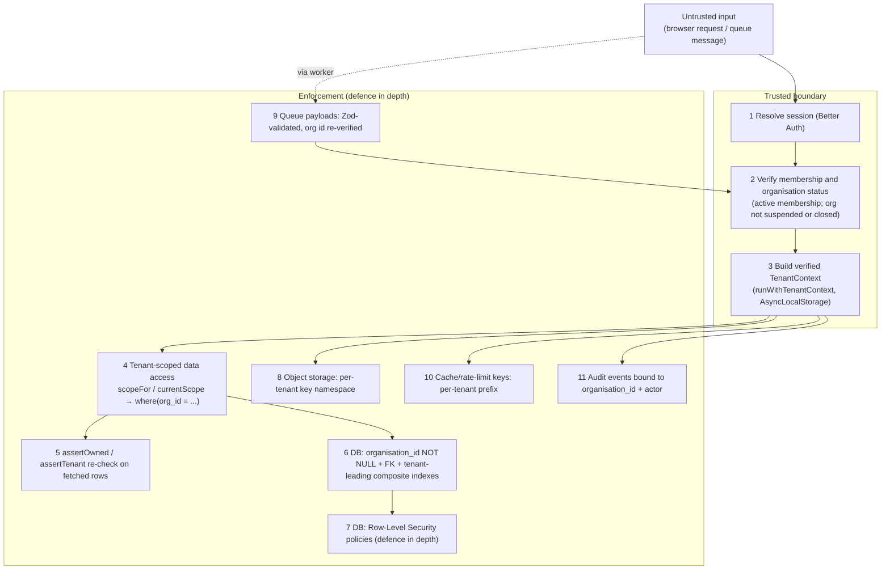

# Tenant isolation

BlakPath is multi-tenant: many authorised organisations share one deployment,
and **their data must never leak across the tenant boundary.** This is the
single most important security property in the system after "the software never
determines Aboriginality".

The model is **defence in depth**: no one control is trusted on its own. A row
would have to defeat several independent guards to cross tenants.

## Non-negotiables

- Every tenant-owned row carries a non-null `organisation_id`
  (`organisationId()` helper in `src/db/schema/_helpers.ts`).
- The organisation id is **never** trusted from the browser, a URL, a form field
  or a queue message. It is **derived from the authenticated session and
  DB-verified against the user's membership** before any tenant work begins.
- The `organisations` table is the tenant boundary itself, so it carries **no**
  `organisation_id` (see `src/db/schema/tenancy.ts`).

## The layers



### 1–3. Verified TenantContext at a trusted boundary

`src/lib/tenancy/context.ts` defines `TenantContext` and carries it through the
call tree with `AsyncLocalStorage`:

- `runWithTenantContext(ctx, fn)` establishes the context at a trusted boundary
  (route handler, server action, or job runner) **after** membership has been
  confirmed against the database.
- `requireTenantContext()` returns it inside tenant-scoped code, or throws
  `TenantContextError` if none is active — so tenant-touching code cannot run
  "context-less".
- The context holds the verified `organisationId`, `userId`, `membershipId`,
  resolved `permissions`, `roles`, `sessionId`, and correlation/request ids used
  for audit attribution.

The context is only ever constructed from DB-verified values. There is no code
path that builds it from a browser-supplied tenant id.

`resolveTenantContext` also refuses a suspended or closed organisation, even
when the membership is active. Staff see a generic unavailable message and
APIs return 403. The same refusal covers public form tokens, API keys and
background jobs. A platform operator changes that status through
`POST /api/admin/organisations/{id}/status`; the change is appended to the
platform audit chain (`organisation.status_changed`), not the tenant chain.

### 4–5. Tenant-scoped data access

All tenant data goes through `src/db/tenant-db.ts` so the `organisation_id`
predicate is applied **centrally** and cannot be forgotten at a call site:

- `currentScope()` derives a `TenantScope` from the active context;
  `scopeFor(orgId)` builds one explicitly (used by jobs/tests).
- `scope.where(orgColumn, ...extra)` always AND-s
  `eq(organisation_id, scope.organisationId)` in front of caller predicates.
- `scope.insertValues(values)` spreads the tenant id into every insert so it is
  always set.
- `scope.assertOwned(row)` throws `TenantIsolationError` if a fetched row's tenant
  differs from the scope — a safety net for any query accidentally written
  without the predicate. `assertTenant(expected, actual)` is the same guard for
  hot paths and tests.

The raw `db` client (`src/db/client.ts`) is reserved for auth, platform-level
tables, migrations and infrastructure — **not** for tenant-owned data. Code
that must see more than one tenant uses `platformDb` (layer 7).

### 6. Database constraints & indexes

- Tenant-owned `organisation_id` columns that reference `organisations.id`
  use `ON DELETE CASCADE`, so closing a tenant removes those rows. `roles` and
  `feature_flags` allow null for platform defaults. `audit_events` and
  `audit_integrity_checkpoints` allow null for the platform chain and have no
  organisation foreign key, so closing a tenant does not erase that chain.
- Uniqueness that must be per-tenant is expressed as a **composite** unique index
  leading with `organisation_id` (e.g. `memberships_org_user_unique`,
  `organisation_settings_org_unique`, `roles_org_slug_unique`).
- Listing/lookup indexes lead with `organisation_id`
  (e.g. `memberships_org_status_idx`,
  `representative_authorisations_org_subject_idx`,
  `audit_events_org_timestamp_idx`) so scoped queries are both correct and fast.

### 7. Row-Level Security (defence in depth)

Every table with an `organisation_id` column (60 tables) has `ENABLE` and
`FORCE ROW LEVEL SECURITY` and the policy `tenant_isolation`
(`src/db/schema/_rls.ts`, migration `0043_tenant_rls.sql`), `FOR ALL`:

```sql
USING (blakpath_rls_allows(organisation_id))
WITH CHECK (blakpath_rls_allows(organisation_id))
```

`blakpath_rls_allows` is an inlined `STABLE` SQL function over two
transaction-local settings:

| Setting                 | Set by                                              | Rows allowed                                                                 |
| ----------------------- | --------------------------------------------------- | ---------------------------------------------------------------------------- |
| `app.bypass_rls = 'on'` | `platformDb` (`src/db/platform-db.ts`)              | all                                                                          |
| `app.org_id = <uuid>`   | `scopeFor` / `currentScope` (`src/db/tenant-db.ts`) | that organisation only, for reads and for the new row of an insert or update |
| neither                 | release N-1, raw `db`                               | all, until phase 2 (below)                                                   |

`roles` and `feature_flags` also have `tenant_shared_read`, so a tenant can
`SELECT` platform defaults (`organisation_id IS NULL`). That policy is not on
`audit_events` or `audit_integrity_checkpoints`: a null organisation there is
the platform chain and stays invisible to tenants, and a tenant cannot insert
into it.

**How the settings are applied.** `scope.db` and `platformDb` are real Drizzle
handles whose client (`src/db/bound-db.ts`) runs each statement inside a
transaction that first calls `set_config(..., true)` (`SET LOCAL`) for
`app.org_id`, `app.bypass_rls`, and `role`. Nothing survives the transaction,
so pooled connections cannot leak a tenant. Inside `scope.db.transaction(...)`
every bound handle with the same context reuses that transaction, and a
different context (for example `platformDb` inside a tenant transaction) runs
in a savepoint after which the outer context is restored. Do not run two
contexts concurrently (`Promise.all`) inside one transaction: they share one
connection.

**Roles.** Production connects as `blakpath_app` (non-owner, no
`BYPASSRLS`). The role switch is a no-op there. Local and CI connect as a
superuser, which bypasses RLS even when forced, so a bound transaction does
`SET LOCAL ROLE blakpath_app` (`AUDIT_DB_APP_ROLE`) when the session may assume
it. `pnpm db:migrate` creates that role `NOLOGIN` outside production. This makes
every integration test that goes through `scope.db` or `platformDb` run under
the policies with production grants. `tests/integration/tenant-rls.test.ts`
also logs in as a separate non-owner role to prove refusals without any role
switch. No migration creates roles or needs `BYPASSRLS`/`CREATEROLE`.

**Bypass.** `platformDb` is the only bypass. ESLint
(`no-restricted-imports`) limits who may import it and who may import the raw
client, and `tests/unit/tenant-db-import-guard.test.ts` pins both lists; adding a
caller means editing that test, which is the review point. Every bypass caller
is listed there with its reason.

**Rollout (expand, then contract).** Release N-1 sets no context and must keep
working on schema N, so phase 1 (this release) lets an unset context through.
Bound handles always set one, so every scoped and platform query is already
enforced. Phase 2, a migration in a later release once N-1 is gone, replaces
the unset branch with `false`:

```sql
CREATE OR REPLACE FUNCTION blakpath_rls_allows(row_org uuid) RETURNS boolean
LANGUAGE sql STABLE PARALLEL SAFE AS $rls$
  SELECT CASE
    WHEN pg_catalog.current_setting('app.bypass_rls', true) = 'on' THEN true
    WHEN COALESCE(pg_catalog.current_setting('app.org_id', true), '') = '' THEN false
    ELSE row_org = pg_catalog.current_setting('app.org_id', true)::uuid
  END
$rls$;
```

After phase 2 a raw-`db` query on a tenant table, and a data migration run as
the owner (RLS is forced), sees no rows unless it sets
`app.bypass_rls`. Data migrations must start with
`SELECT set_config('app.bypass_rls', 'on', true);`.

**Operational cost.** Each bound statement outside a caller transaction is
`BEGIN`, one `set_config` select, the statement, `COMMIT`. `set_config` pins an
RDS Proxy session for its lifetime (as do the audit chain's advisory locks),
so the proxy multiplexes less.

### 8. Object-storage namespace

Evidence objects are keyed under a per-tenant namespace
(`{organisation_id}/...`) across the evidence and quarantine buckets. Presigned
URLs are minted only for keys inside the caller's tenant namespace, so one
tenant can never address another tenant's objects
(`docs/evidence-scanning-design.md`).

### 9. Queue payload validation

BullMQ job payloads are **untrusted input**. Every payload is validated with Zod
(`tenantJobSchema`) at enqueue and parsed again when the worker consumes it.
The worker then loads the organisation and drops the job unless that row is
`active`, auditing the drop, before a processor opens a tenant scope. A forged,
malformed, or stale message cannot widen access.

### 10. Cache & rate-limit key prefixing

Any Redis-backed cache, lock or rate-limit key that holds tenant-derived data is
prefixed with the organisation id, so cached values cannot bleed between tenants
and per-tenant limits stay independent.

### 11. Audit binding

Every tenant event in `audit_events` is written with its `organisation_id` and
actor, and indexed tenant-first. A null `organisation_id` denotes a
platform-level event only. This means the audit trail is itself tenant-scoped and
cannot be read across the boundary (`docs/audit-log-design.md`).

## Automated isolation tests that must pass

These tests are treated as release gates. Any change that would let one fail must
not merge.

1. **Row insert always stamps the tenant.** `scope.insertValues` sets
   `organisation_id` and overwrites a caller-supplied one.
   Test: `tests/unit/tenant-isolation-gates.test.ts` — `scope.insertValues stamps the organisation id`.
2. **Cross-tenant read returns nothing.** Every exported domain read/write is
   called as tenant A with tenant B's resource ids. The result is empty or an
   error, it does not contain B's rows, and B's rows do not change. Worker and
   audit-chain functions that take an organisation id as their scope keep A's
   id, and B's resource ids are the other arguments.
   Test: `tests/integration/cross-tenant.test.ts` — `calls every exported domain function as org A with org B ids`.
   The case list is `tests/integration/cross-tenant-cases.json`, counted by
   `tests/unit/cross-tenant-coverage.test.ts`.
3. **`assertOwned` rejects foreign rows.** Handing a tenant-B row to tenant A's
   scope throws `TenantIsolationError`.
   Test: `tests/unit/tenant-isolation-gates.test.ts` — `assertOwned rejects a foreign row`.
4. **`assertTenant` mismatch throws.** Mismatched expected/actual org ids throw.
   Test: `tests/unit/tenant-isolation-gates.test.ts` — `assertTenant throws on mismatch`.
5. **Missing context throws.** Calling `currentScope()` /
   `requireTenantContext()` with no active context throws `TenantContextError`.
   Test: `tests/unit/tenant-isolation-gates.test.ts` — `currentScope throws without a tenant context`.
6. **Browser-supplied org id is ignored.** A request carrying an
   `organisation_id` for a tenant the user is not a member of is refused; the
   context is built only from the DB-verified membership.
   Test: `tests/unit/tenancy-resolve.test.ts` — `rejects a user with no active membership of the supplied org`.
7. **RLS backstop blocks cross-tenant reads and writes.** Logged in as a
   non-owner, non-superuser role with org A set, a query with no tenant
   predicate returns none of org B on every tenant table; updates and deletes
   of B's rows affect nothing; moving or inserting a row into B, or into the
   platform chain, is refused by the policy.
   Test: `tests/integration/tenant-rls.test.ts`. The catalog check there and
   `tests/unit/tenant-rls-migration.test.ts` fail if any table with an
   `organisation_id` column lacks forced RLS or `tenant_isolation`.
8. **Object-key namespace enforced.** Presigning or reading an object key outside
   the caller's `{organisation_id}/` prefix is refused.
   Test: `tests/unit/tenant-isolation-gates.test.ts` — `presignUpload refuses a foreign object key`.
9. **Queue payload missing a tenant is rejected.** `assertTenantJob` refuses a
   payload with no `organisationId` or `correlationId`, so it is not enqueued.
   A well-formed organisation id is not proven at enqueue time. The worker
   rebuilds the context from that id and the call fails closed when the actor
   has no membership, covered by gate 6.
   Test: `tests/unit/tenant-isolation-gates.test.ts` — `assertTenantJob rejects a payload without organisationId`.
10. **Cache keys are tenant-prefixed.** `tenantKey` always starts with
    `bp:org:{organisationId}:`, so a key built for tenant A is not the key
    tenant B reads.
    Test: `tests/unit/tenant-isolation-gates.test.ts` — `tenantKey prefixes the organisation id`.
11. **Audit reads are tenant-scoped.** As the app role for tenant A, a
    predicate-less read of `audit_events` returns none of tenant B's events and
    none of the platform (null-org) chain.
    Test: `tests/integration/tenant-rls.test.ts` — `a tenant transaction reads none of another organisation, on every table`
    (the audit tables are part of that sweep).
12. **Cascade on tenant close.** Where `organisation_id` references
    `organisations.id`, the foreign key is `ON DELETE CASCADE`. The append-only
    audit chain and `destruction_certificates` (proof of a crypto-shred) are
    the exceptions: they have no organisation foreign key.
    Test: `tests/unit/tenant-isolation-gates.test.ts` — `organisation foreign keys cascade, except records that must outlive the tenant`.
