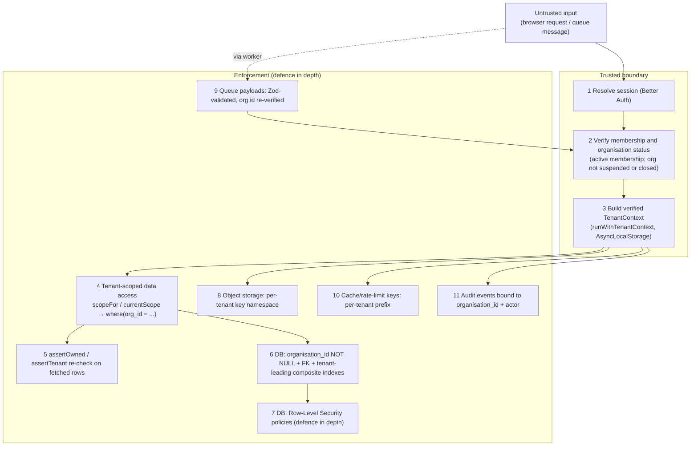

# Tenant isolation

BlakPath is multi-tenant: many authorised organisations share one deployment,
and **their data must never leak across the tenant boundary.** This is the
single most important security property in the system after "the software never
determines Aboriginality".

The model is **defence in depth**: no one control is trusted on its own. A row
would have to defeat several independent guards to cross tenants.

## Non-negotiables

- Every tenant-owned row carries a non-null `organisation_id`
  (`organisationId()` helper in `src/db/schema/_helpers.ts`).
- The organisation id is **never** trusted from the browser, a URL, a form field
  or a queue message. It is **derived from the authenticated session and
  DB-verified against the user's membership** before any tenant work begins.
- The `organisations` table is the tenant boundary itself, so it carries **no**
  `organisation_id` (see `src/db/schema/tenancy.ts`).

## The layers



### 1–3. Verified TenantContext at a trusted boundary

`src/lib/tenancy/context.ts` defines `TenantContext` and carries it through the
call tree with `AsyncLocalStorage`:

- `runWithTenantContext(ctx, fn)` establishes the context at a trusted boundary
  (route handler, server action, or job runner) **after** membership has been
  confirmed against the database.
- `requireTenantContext()` returns it inside tenant-scoped code, or throws
  `TenantContextError` if none is active — so tenant-touching code cannot run
  "context-less".
- The context holds the verified `organisationId`, `userId`, `membershipId`,
  resolved `permissions`, `roles`, `sessionId`, and correlation/request ids used
  for audit attribution.

The context is only ever constructed from DB-verified values. There is no code
path that builds it from a browser-supplied tenant id.

`resolveTenantContext` also refuses a suspended or closed organisation, even
when the membership is active. Staff see a generic unavailable message and
APIs return 403. The same refusal covers public form tokens, API keys and
background jobs. A platform operator changes that status through
`POST /api/admin/organisations/{id}/status`; the change is appended to the
platform audit chain (`organisation.status_changed`), not the tenant chain.

### 4–5. Tenant-scoped data access

All tenant data goes through `src/db/tenant-db.ts` so the `organisation_id`
predicate is applied **centrally** and cannot be forgotten at a call site:

- `currentScope()` derives a `TenantScope` from the active context;
  `scopeFor(orgId)` builds one explicitly (used by jobs/tests).
- `scope.where(orgColumn, ...extra)` always AND-s
  `eq(organisation_id, scope.organisationId)` in front of caller predicates.
- `scope.insertValues(values)` spreads the tenant id into every insert so it is
  always set.
- `scope.assertOwned(row)` throws `TenantIsolationError` if a fetched row's tenant
  differs from the scope — a safety net for any query accidentally written
  without the predicate. `assertTenant(expected, actual)` is the same guard for
  hot paths and tests.

The raw `db` client (`src/db/client.ts`) is reserved for auth, platform-level
tables, migrations and infrastructure — **not** for tenant-owned data.

### 6. Database constraints & indexes

- Tenant-owned `organisation_id` columns that reference `organisations.id`
  use `ON DELETE CASCADE`, so closing a tenant removes those rows. `roles` and
  `feature_flags` allow null for platform defaults. `audit_events` and
  `audit_integrity_checkpoints` allow null for the platform chain and have no
  organisation foreign key, so closing a tenant does not erase that chain.
- Uniqueness that must be per-tenant is expressed as a **composite** unique index
  leading with `organisation_id` (e.g. `memberships_org_user_unique`,
  `organisation_settings_org_unique`, `roles_org_slug_unique`).
- Listing/lookup indexes lead with `organisation_id`
  (e.g. `memberships_org_status_idx`,
  `representative_authorisations_org_subject_idx`,
  `audit_events_org_timestamp_idx`) so scoped queries are both correct and fast.

### 7. Row-Level Security (defence in depth)

Every table with `organisation_id` has `ENABLE` and `FORCE ROW LEVEL SECURITY`.
Policy `tenant_isolation` (`src/db/schema/_rls.ts`) is `FOR ALL`:

```sql
USING (organisation_id = current_setting('app.org_id')::uuid)
WITH CHECK (organisation_id = current_setting('app.org_id')::uuid)
```

`roles` and `feature_flags` also have `tenant_shared_read`, so a tenant can
`SELECT` platform defaults (`organisation_id IS NULL`). That policy is not on
`audit_events` or `audit_integrity_checkpoints`: a null organisation there is
the platform chain and stays invisible to tenants.

Tenant queries run in a transaction as `blakpath_app` (`NOBYPASSRLS`) after
`SET LOCAL app.org_id`. `TenantScope.db` (`src/db/bound-db.ts`) opens that
transaction, so a forgotten `eq(organisationId)` is still filtered. An unset
`app.org_id` makes the cast fail closed.

`blakpath_platform` is `BYPASSRLS` and is only for vetted pre-tenant paths
(membership resolution, token lookup, public verification). `src/db/migrate.ts`
creates both roles before the SQL migrations, because `CREATE ROLE` cannot run
inside the transaction drizzle wraps a migration in. The migrator needs to be a
superuser or have `CREATEROLE`. `0020_rls-force-and-roles.sql` grants the roles
to the migrator and forces RLS. Table owners are subject to the policies
because RLS is forced. Superusers still bypass them, which is why application
work must `SET ROLE` to `blakpath_app`. If the runtime role is not the
migrator, grant both roles to that runtime role as well.

### 8. Object-storage namespace

Evidence objects are keyed under a per-tenant namespace
(`{organisation_id}/...`) across the evidence and quarantine buckets. Presigned
URLs are minted only for keys inside the caller's tenant namespace, so one
tenant can never address another tenant's objects
(`docs/evidence-scanning-design.md`).

### 9. Queue payload validation

BullMQ job payloads are **untrusted input**. Every payload is validated with Zod
(`tenantJobSchema`) at enqueue and parsed again when the worker consumes it.
The worker then loads the organisation and drops the job unless that row is
`active`, auditing the drop, before a processor opens a tenant scope. A forged,
malformed, or stale message cannot widen access.

### 10. Cache & rate-limit key prefixing

Any Redis-backed cache, lock or rate-limit key that holds tenant-derived data is
prefixed with the organisation id, so cached values cannot bleed between tenants
and per-tenant limits stay independent.

### 11. Audit binding

Every tenant event in `audit_events` is written with its `organisation_id` and
actor, and indexed tenant-first. A null `organisation_id` denotes a
platform-level event only. This means the audit trail is itself tenant-scoped and
cannot be read across the boundary (`docs/audit-log-design.md`).

## Automated isolation tests that must pass

These tests are treated as release gates. Any change that would let one fail must
not merge.

1. **Row insert always stamps the tenant.** `scope.insertValues` sets
   `organisation_id` and overwrites a caller-supplied one.
   Test: `tests/unit/tenant-isolation-gates.test.ts` — `scope.insertValues stamps the organisation id`.
2. **Cross-tenant read returns nothing.** Every exported domain read/write is
   called as tenant A with tenant B's resource ids. The result is empty or an
   error, it does not contain B's rows, and B's rows do not change. Worker and
   audit-chain functions that take an organisation id as their scope keep A's
   id, and B's resource ids are the other arguments.
   Test: `tests/integration/cross-tenant.test.ts` — `calls every exported domain function as org A with org B ids`.
   The case list is `tests/integration/cross-tenant-cases.json`, counted by
   `tests/unit/cross-tenant-coverage.test.ts`.
3. **`assertOwned` rejects foreign rows.** Handing a tenant-B row to tenant A's
   scope throws `TenantIsolationError`.
   Test: `tests/unit/tenant-isolation-gates.test.ts` — `assertOwned rejects a foreign row`.
4. **`assertTenant` mismatch throws.** Mismatched expected/actual org ids throw.
   Test: `tests/unit/tenant-isolation-gates.test.ts` — `assertTenant throws on mismatch`.
5. **Missing context throws.** Calling `currentScope()` /
   `requireTenantContext()` with no active context throws `TenantContextError`.
   Test: `tests/unit/tenant-isolation-gates.test.ts` — `currentScope throws without a tenant context`.
6. **Browser-supplied org id is ignored.** A request carrying an
   `organisation_id` for a tenant the user is not a member of is refused; the
   context is built only from the DB-verified membership.
   Test: `tests/unit/tenancy-resolve.test.ts` — `rejects a user with no active membership of the supplied org`.
7. **RLS backstop blocks a predicate-less query.** With org A set on
   `blakpath_app`, a query with no tenant predicate returns none of org B.
   Test: `tests/integration/tenant-rls.test.ts` — `predicate-less query as the app role returns none of org B`.
   `tests/unit/tenant-rls-migration.test.ts` asserts `ENABLE`, `FORCE`, and
   `tenant_isolation` in the migration SQL for every tenant table.
8. **Object-key namespace enforced.** Presigning or reading an object key outside
   the caller's `{organisation_id}/` prefix is refused.
   Test: `tests/unit/tenant-isolation-gates.test.ts` — `presignUpload refuses a foreign object key`.
9. **Queue payload missing a tenant is rejected.** `assertTenantJob` refuses a
   payload with no `organisationId` or `correlationId`, so it is not enqueued.
   A well-formed organisation id is not proven at enqueue time. The worker
   rebuilds the context from that id and the call fails closed when the actor
   has no membership, covered by gate 6.
   Test: `tests/unit/tenant-isolation-gates.test.ts` — `assertTenantJob rejects a payload without organisationId`.
10. **Cache keys are tenant-prefixed.** `tenantKey` always starts with
    `bp:org:{organisationId}:`, so a key built for tenant A is not the key
    tenant B reads.
    Test: `tests/unit/tenant-isolation-gates.test.ts` — `tenantKey prefixes the organisation id`.
11. **Audit reads are tenant-scoped.** As the app role for tenant A, a
    predicate-less read of `audit_events` returns none of tenant B's events and
    none of the platform (null-org) chain.
    Test: `tests/integration/tenant-rls.test.ts` — `predicate-less query as the app role returns none of org B`
    (the audit tables are part of that sweep).
12. **Cascade on tenant close.** Where `organisation_id` references
    `organisations.id`, the foreign key is `ON DELETE CASCADE`. The append-only
    audit chain is the exception: it has no organisation foreign key.
    Test: `tests/unit/tenant-isolation-gates.test.ts` — `organisation foreign keys cascade, except the append-only audit chain`.
