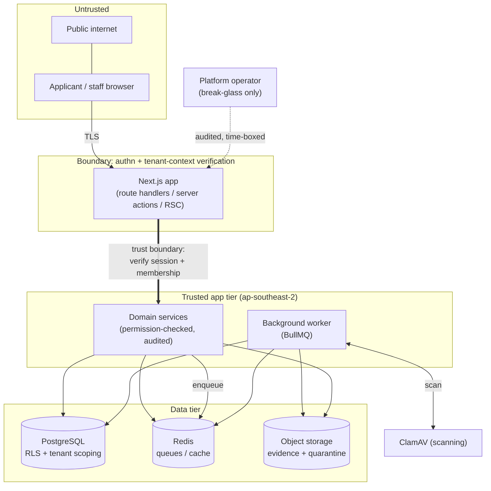
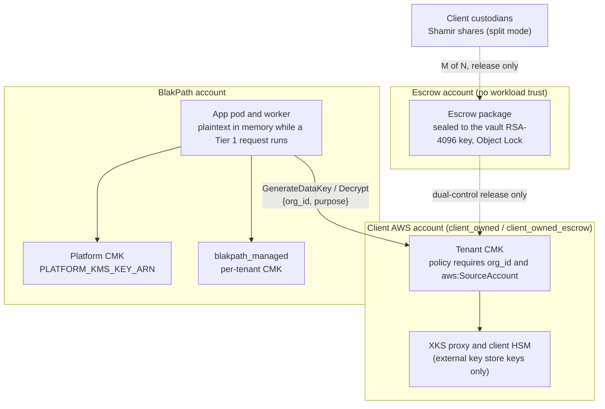

# Threat model

BlakPath holds some of the most sensitive information a person can share:
evidence of their identity, their family and ancestry, and the decisions an
authorised organisation makes about their Confirmation of Aboriginality. A breach
here is not just a data-protection failure — it is a cultural and personal harm.
This document sets out what we protect, where trust boundaries lie, the main
threats (STRIDE), the mitigations, and our **fail-secure** stance.

> The most important safety property is upstream of everything here: **BlakPath
> never determines Aboriginality.** There is no model to poison, no score to
> game, no automated decision to subvert — determination authority rests with
> authorised humans (`docs/privacy-architecture.md`).

## Assets

| Asset                          | Why it matters                                         | Where it lives                                                                                       |
| ------------------------------ | ------------------------------------------------------ | ---------------------------------------------------------------------------------------------------- |
| **Identity evidence**          | Uploaded documents proving identity; highly sensitive. | Object storage (evidence/quarantine buckets), `ap-southeast-2`.                                      |
| **Genealogy / ancestry**       | Family relationships and ancestry records.             | PostgreSQL (later-phase domain), tenant-scoped.                                                      |
| **Determinations & decisions** | Human-recorded outcomes and their reasoning.           | PostgreSQL, tenant-scoped; recorded via audited actions.                                             |
| **Certificates**               | Issued Confirmation certificates.                      | PostgreSQL + object storage; issue/revoke audited.                                                   |
| **Authentication secrets**     | Password hashes, TOTP secrets, recovery codes.         | Argon2 passwords. TOTP material encrypted by Better Auth under `BETTER_AUTH_SECRET`, not KMS.        |
| **Audit trail**                | Tamper-evident record of who did what.                 | `audit_events` (append-only, hash-chained) plus daily signed heads in the object-lock anchor bucket. |
| **Tenant boundary metadata**   | `organisation_id` on every tenant row.                 | PostgreSQL.                                                                                          |

## Trust boundaries

The critical boundary is between **untrusted input** (browser requests, queue
messages) and the **trusted app tier**. Nothing crosses it without a resolved
session and a **DB-verified** tenant context; nothing supplied by the client is
trusted as a tenant id (`docs/tenant-isolation.md`).

The app tier is trusted to enforce authorisation. It is **not** a
confidentiality boundary for tenant data. Today those rows are plaintext in
PostgreSQL. Under the accepted Tier 1 design (not built), the process holds
plaintext in memory while it handles a request. See
[Key custody and escrow](#key-custody-and-escrow).

## STRIDE analysis

### Spoofing

- **Threat:** impersonating a user or another tenant.
- **Mitigations:** Better Auth sessions; argon2 password hashing; **mandatory
  staff MFA** (passkeys or verified TOTP, enforced before tenant access);
  step-up re-auth for sensitive actions; sessions
  bound server-side with `ipAddress`/`userAgent`. `ipAddress` is
  `CF-Connecting-IP` only after the origin-verify secret matches (`clientIp`);
  a forwarded-for header is not a client identity. Tenant id is derived from the
  verified membership, never the request (`docs/authentication.md`).
  Cookie-authenticated `/api` mutations require the application origin and a
  JSON content type. Production session cookies use the `__Host-` prefix.

### Tampering

- **Threat:** altering records, evidence, or the audit trail.
- **Mitigations:** append-only, **SHA-256 hash-chained** audit with periodic
  integrity checkpoints; DB privileges deny UPDATE/DELETE on audit tables;
  optimistic concurrency (`rowVersion`) on mutable records; Zod validation on all
  inputs and queue payloads; object integrity verified during the scan lifecycle
  (`docs/audit-log-design.md`, `docs/evidence-scanning-design.md`).

### Repudiation

- **Threat:** a user denying an action they performed.
- **Mitigations:** every sensitive action — including **denials** — is audited
  with actor, acting role, session, correlation id and result. Recording and
  reviewing determinations, and issuing/revoking certificates, are all audited.
  The hash chain makes the record non-repudiable. CloudTrail and EKS
  control-plane logs are the platform record of AWS and Kubernetes API calls.
  They do not decide identity.

### Information disclosure

- **Threat:** leaking evidence, genealogy or decisions — especially across
  tenants.
- **Mitigations:** layered tenant isolation (application scoping + `assertOwned`
  - `NOT NULL` FKs + composite indexes + **RLS backstop**); per-tenant
    object-storage namespaces and short-lived presigned URLs; **per-tenant
    envelope encryption (AES-256-GCM)** under that organisation's KMS key,
    for the inventoried columns and objects only (other tenant columns are
    plaintext), failing closed when the key is unavailable, including after the key is
    deleted so backup ciphertext under that CMK cannot be opened; TLS in transit
    (Cloudflare Full (strict) to an HTTPS origin listener; HTTP only redirects);
    audit redaction of secrets and payloads (not a claim that audit metadata has
    no personal data — `ipAddress` and `userAgent` are stored, #80); least-privilege
    RBAC; **no standing operator access** (break-glass only); runtime secrets
    sync only into the `blakpath` namespace; public certificate checks return
    no holder name and compare a typed name with a salted hash
    (`docs/tenant-isolation.md`, `docs/privacy-architecture.md`,
    `docs/eks-runbook.md`).

### Denial of service

- **Threat:** overwhelming the app, the scanner, or the queues.
- **Mitigations:** Redis-backed rate limiting keyed by the trusted client
  address, including public certificate lookups and holder-name checks;
  regional WAFv2 managed rules on the origin load balancer; bounded upload
  sizes/types; presigned uploads keep large transfers off the app tier; BullMQ
  retries with backoff and dead-lettering; a tenant whose key is unavailable has
  its jobs delayed rather than retried to exhaustion, and other tenants are not
  paused; a stalled scanner **holds** files in
  quarantine rather than failing open (fail-secure, below).

### Elevation of privilege

- **Threat:** gaining permissions or crossing the tenant boundary.
- **Mitigations:** access requires active membership → role → permission key,
  resolved and cached only from DB-verified data; **separation of duties**
  (record ≠ review ≠ certify; admin ≠ adjudicate); platform-operator flag grants
  no tenant data; break-glass is scoped, time-boxed, step-up verified,
  tenant-notified and fully audited (`docs/authorization-matrix.md`).

## Key custody and escrow

Decision: [`docs/adr/0001-customer-held-keys.md`](adr/0001-customer-held-keys.md).
Client summary: [`docs/customer-held-keys.md`](customer-held-keys.md). The
three Tier 1 custody modes (`blakpath_managed`, `client_owned`,
`client_owned_escrow`) are built. Tier 2 client-side encryption:
**Not implemented** (#124). The live XKS proxy test is deferred
(`docs/adr/0121-client-held-keys.md`). Each entry below says what the code
does now and what is still open.

Tier 1 keeps plaintext in server memory for the life of the request or job.
Tier 2 would not: the server would store ciphertext for those classes and
never get the key. A compromised pod reads every Tier 1 tenant whose key the
workload role can still use.

### Spoofing

- Every KMS call carries `{org_id, purpose}`. The client key policy
  (`infra/client-kms`) requires `kms:EncryptionContext:org_id` and
  `aws:SourceAccount`. Registration runs a handshake that must also see a
  negative `Decrypt` and `GenerateDataKey` refused under
  `org_id=blakpath-handshake-negative`; until it passes, the key stays
  `pending_validation` and the organisation cannot be activated.
- Encryption context is not end-user authentication. User spoofing stays the
  session problem in the STRIDE section above.
- TOTP material is protected by `BETTER_AUTH_SECRET`, not by a tenant key.

### Tampering

- AES-256-GCM AAD binds each version-2 envelope to its table, column, row and
  organisation, so a value moved to another row or tenant fails to decrypt.
  The envelope records the key ARN and version.
- `escrow = true` is refused by a database CHECK unless the consent
  reference, signing date and package digest are all present. The escrow
  package is in a separate account under Object Lock, not in a row the app
  can update.

### Repudiation

- In `client_owned` and `client_owned_escrow`, every `GenerateDataKey` and
  `Decrypt` is in the **client's** CloudTrail. `blakpath_managed` does **not**
  give the client that trail. Do not claim it does.
- Key registration, validation, status changes, rotation, escrow opt-in and
  withdrawal append platform audit events (`key.*`). Escrow release steps are
  logged in the vault trail. No key material or share is written to either.

### Information disclosure

- A stolen database or backup discloses ciphertext for the inventoried
  columns and objects, and plaintext for every other tenant column (see the
  column inventory in `docs/privacy-architecture.md`).
- The operator reads `blakpath_managed` tenants by using that CMK. For
  client-held modes the operator reads Tier 1 plaintext only by running the
  app while the client's key allows it.
- Escrow in **whole** mode means BlakPath's vault holds a full copy of the key
  material, sealed to the vault key and opened only under dual control. In
  **split** mode the vault keeps the manifest and each custodian holds one
  share sealed to the vault key, so neither side recovers alone. The client
  chooses at the ceremony.
- AWS does not receive XKS material. Tier 1 does not hide plaintext from a
  compromised pod. Audit rows are on the platform side and still hold
  `ipAddress` and `userAgent` (#80, open).

### Denial of service

- A disabled, pending-deletion or unreachable key fails closed for **that**
  tenant (`TenantKeyUnavailableError`, HTTP 423/503). `AccessDeniedException`,
  `DisabledException` and `KMSInvalidStateException` also mark the key
  `unavailable` and evict that tenant's cached data keys. Other tenants
  continue. There is no platform-key fallback.
- Cached data keys live at most 5 minutes and 64 uses. The health sweep runs
  every `KEY_HEALTH_INTERVAL_MS` (default 5 minutes) and alerts on a state
  change.
- Throttling and `NotFoundException` fail the request without a fallback.
  BlakPath adds no retry on top of the AWS SDK defaults.
- Availability of a client-held tenant depends on the client's KMS key, and
  for XKS on their proxy and HSM. That is accepted.

### Elevation of privilege

- The workload role is limited to `GenerateDataKey`, `Decrypt`, `Encrypt` and
  `DescribeKey` on client keys. It must not hold `kms:DisableKey`,
  `kms:ScheduleKeyDeletion`, `kms:PutKeyPolicy` or `kms:CreateGrant`.
- The escrow key policy denies every principal outside the vault account and
  names the workload account in a second deny. Stealing the pod does not
  yield the escrow package.
- Release needs two named escrow officers with split duties (A enables and
  retrieves, B decrypts), the client's authorised signatories, a cooling-off
  period, and M custodians in split mode.
- An insider who can change IAM in the BlakPath account can use a
  `blakpath_managed` CMK. That mode is operator-held.

### Escrow threats

| Threat              | STRIDE                              | Control in the code and runbook                                                                                                                                                                                                                       | Still open                                                                                    |
| ------------------- | ----------------------------------- | ----------------------------------------------------------------------------------------------------------------------------------------------------------------------------------------------------------------------------------------------------- | --------------------------------------------------------------------------------------------- |
| Insider at BlakPath | Information disclosure, elevation   | Escrow is opt-in. The package is in a separate account, sealed to a KMS key that is disabled between ceremonies, under dual control with split officer duties. The workload role cannot reach it. Live decrypt still follows the client's key policy. | In whole mode two colluding officers can open the full material. Split mode removes that.     |
| Coercion            | Information disclosure, repudiation | Release requires the client's signatories, call-back verification and a cooling-off notice to every registered contact. The live path is the client's key: the client can disable it. Not a statement of legal immunity.                              | A legal order served on BlakPath could target the whole-mode package. Counsel review is #42.  |
| Lost custodians     | Denial of service                   | Split mode with M-of-N. Recovery refuses fewer than M shares and checks the key check value. Annual drill in staging (`docs/restore-drills/`).                                                                                                        | Succession of custodians is a client process recorded in the agreement, not enforced by code. |

Release rules (consent specific to escrow, verified signatories, cooling-off,
dual control, import into a **new** client key, rotation afterwards) are in
[`docs/key-escrow-runbook.md`](key-escrow-runbook.md). The opt-in is recorded
with `recordEscrowOptIn`, which refuses any custody mode other than
`client_owned_escrow`. `organisation_settings.consentWording` is not escrow
consent.

## Fail-secure stance

When something goes wrong, BlakPath **denies rather than exposes**:

- **Scanner unavailable → quarantine holds.** If ClamAV is down, unreachable or
  errors, the uploaded file stays in the quarantine bucket and is **never
  promoted or served**. Availability of scanning is never traded for exposing an
  unscanned file (`docs/evidence-scanning-design.md`). GuardDuty Malware
  Protection for S3, when enabled, is a second signal only. Its object tag
  never promotes or rejects evidence.
- **No tenant context → refuse.** Tenant-touching code with no active verified
  context throws `TenantContextError`; it does not guess a tenant.
- **Permission ambiguous → deny.** A missing or unresolved permission is a
  `denied` result (audited), not a default-allow.
- **Config invalid → don't boot.** `src/lib/env.ts` fails fast on malformed
  configuration rather than starting with unsafe defaults.
- **Outbound webhook → public HTTPS only.** Endpoint URLs are refused unless
  they are HTTPS names that resolve to global addresses. The same check runs
  again when the worker opens the socket. Redirects are not followed. Signing
  secrets are envelope-encrypted, returned once on create or rotation, and
  omitted from list responses. Cluster-specific ranges can be added with
  `WEBHOOK_DENY_CIDRS`. The worker is the only pod with public egress, and
  only on TCP 443 outside private ranges (`infra/k8s/network-policy.yaml`).
- **AI off by default.** `AI_FEATURES_ENABLED` defaults to `false`, and even when
  on, AI can never decide, score or infer identity. External tool access also
  needs a tenant opt-in (step-up, recorded governance approval) and an `mcp:`
  scope (`docs/privacy-architecture.md`).
- **Tenant key unavailable → that tenant fails closed.** A disabled,
  pending-deletion or unreachable key raises `TenantKeyUnavailableError`
  (HTTP 423/503, `TENANT_KEY_UNAVAILABLE`). There is no plaintext or
  platform-key fallback. An organisation cannot become `active` until its key
  has passed the validation handshake
  ([`docs/adr/0001-customer-held-keys.md`](adr/0001-customer-held-keys.md)).

## Residual risks & assumptions

- Cultural governance and the correctness of human determinations sit with the
  organisation; BlakPath assures process integrity, not the merits of a decision.
- Namespace network policy is defined in `infra/k8s/network-policy.yaml`
  (default deny). It takes effect only after the EKS Auto Mode controller is
  enabled and the manifests are applied (`docs/eks-runbook.md`). Node
  placement, backups and patching are enforced in the `ap-southeast-2`
  deployment. Secret sync and the API
  endpoint contract are in `docs/eks-runbook.md`. The dedicated cluster is
  `docs/adr/0001-dedicated-cluster.md`.
- A compromised Tier 1 pod reads plaintext in memory for every tenant whose
  key the workload role can still use. Memory zeroisation is not a control
  against that. Tier 2 (#124, not built) is the only mode in the ADR where the
  server does not see the plaintext.
- Tenant columns outside the inventory in `docs/privacy-architecture.md` are
  plaintext in PostgreSQL. A database copy discloses them without a client key.
