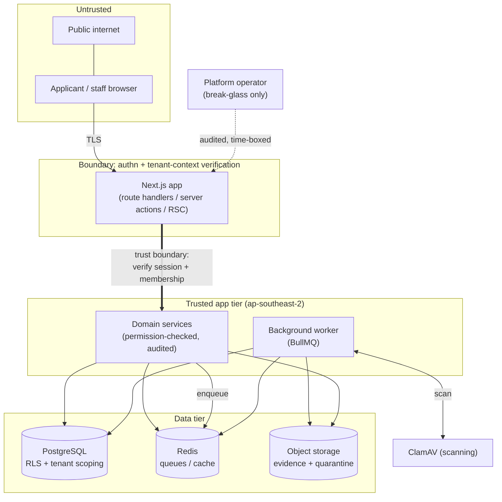
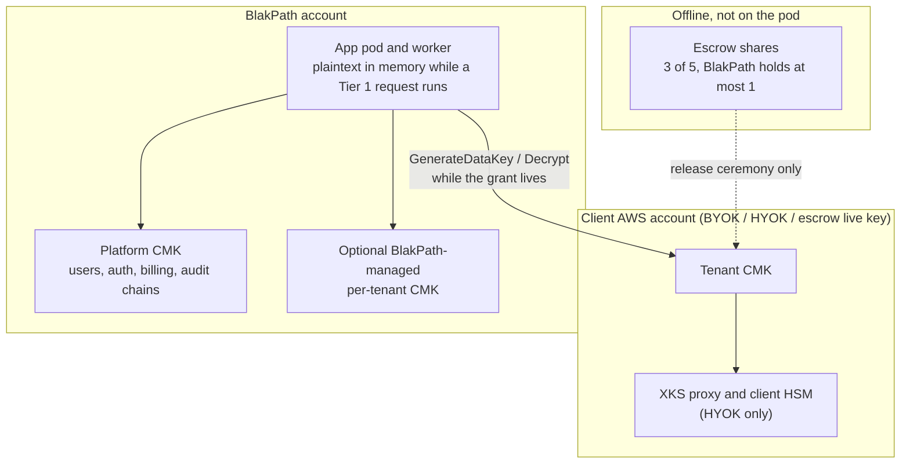

# Threat model

BlakPath holds some of the most sensitive information a person can share:
evidence of their identity, their family and ancestry, and the decisions an
authorised organisation makes about their Confirmation of Aboriginality. A breach
here is not just a data-protection failure — it is a cultural and personal harm.
This document sets out what we protect, where trust boundaries lie, the main
threats (STRIDE), the mitigations, and our **fail-secure** stance.

> The most important safety property is upstream of everything here: **BlakPath
> never determines Aboriginality.** There is no model to poison, no score to
> game, no automated decision to subvert — determination authority rests with
> authorised humans (`docs/privacy-architecture.md`).

## Assets

| Asset                          | Why it matters                                         | Where it lives                                                                                |
| ------------------------------ | ------------------------------------------------------ | --------------------------------------------------------------------------------------------- |
| **Identity evidence**          | Uploaded documents proving identity; highly sensitive. | Object storage (evidence/quarantine buckets), `ap-southeast-2`.                               |
| **Genealogy / ancestry**       | Family relationships and ancestry records.             | PostgreSQL (later-phase domain), tenant-scoped.                                               |
| **Determinations & decisions** | Human-recorded outcomes and their reasoning.           | PostgreSQL, tenant-scoped; recorded via audited actions.                                      |
| **Certificates**               | Issued Confirmation certificates.                      | PostgreSQL + object storage; issue/revoke audited.                                            |
| **Authentication secrets**     | Password hashes, TOTP secrets, recovery codes.         | Argon2 passwords. TOTP material encrypted by Better Auth under `BETTER_AUTH_SECRET`, not KMS. |
| **Audit trail**                | Tamper-evident record of who did what.                 | `audit_events` (append-only, hash-chained).                                                   |
| **Tenant boundary metadata**   | `organisation_id` on every tenant row.                 | PostgreSQL.                                                                                   |

## Trust boundaries

The critical boundary is between **untrusted input** (browser requests, queue
messages) and the **trusted app tier**. Nothing crosses it without a resolved
session and a **DB-verified** tenant context; nothing supplied by the client is
trusted as a tenant id (`docs/tenant-isolation.md`).

The app tier is trusted to enforce authorisation. It is **not** a
confidentiality boundary for tenant data. Today those rows are plaintext in
PostgreSQL. Under the accepted Tier 1 design (not built), the process holds
plaintext in memory while it handles a request. See
[Key custody and escrow](#key-custody-and-escrow).

## STRIDE analysis

### Spoofing

- **Threat:** impersonating a user or another tenant.
- **Mitigations:** Better Auth sessions; argon2 password hashing; **mandatory
  staff MFA** (passkeys/TOTP); step-up re-auth for sensitive actions; sessions
  bound server-side with `ipAddress`/`userAgent`; tenant id derived from the
  verified membership, never the request (`docs/authentication.md`).

### Tampering

- **Threat:** altering records, evidence, or the audit trail.
- **Mitigations:** append-only, **SHA-256 hash-chained** audit with periodic
  integrity checkpoints; DB privileges deny UPDATE/DELETE on audit tables;
  optimistic concurrency (`rowVersion`) on mutable records; Zod validation on all
  inputs and queue payloads; object integrity verified during the scan lifecycle
  (`docs/audit-log-design.md`, `docs/evidence-scanning-design.md`).

### Repudiation

- **Threat:** a user denying an action they performed.
- **Mitigations:** every sensitive action — including **denials** — is audited
  with actor, acting role, session, correlation id and result. Recording and
  reviewing determinations, and issuing/revoking certificates, are all audited.
  The hash chain makes the record non-repudiable.

### Information disclosure

- **Threat:** leaking evidence, genealogy or decisions — especially across
  tenants.
- **Mitigations:** layered tenant isolation (application scoping + `assertOwned`
  - `NOT NULL` FKs + composite indexes + **RLS backstop**); per-tenant
    object-storage namespaces and short-lived presigned URLs; TLS in transit;
    audit redaction of secrets (not a claim that audit metadata has no personal
    data — `ipAddress` and `userAgent` are stored, #80); least-privilege
    RBAC; **no standing operator access** (break-glass only). Application
    envelope encryption is **not** a current control: `encryptField` is unused
    on write paths and tenant columns are plaintext. TOTP material is
    encrypted by Better Auth. Production object bytes use one platform S3 KMS
    key (`docs/tenant-isolation.md`, `docs/privacy-architecture.md`).

### Denial of service

- **Threat:** overwhelming the app, the scanner, or the queues.
- **Mitigations:** Redis-backed, tenant-prefixed rate limiting; bounded upload
  sizes/types; presigned uploads keep large transfers off the app tier; BullMQ
  retries with backoff and dead-lettering; a stalled scanner **holds** files in
  quarantine rather than failing open (fail-secure, below).

### Elevation of privilege

- **Threat:** gaining permissions or crossing the tenant boundary.
- **Mitigations:** access requires active membership → role → permission key,
  resolved and cached only from DB-verified data; **separation of duties**
  (record ≠ review ≠ certify; admin ≠ adjudicate); platform-operator flag grants
  no tenant data; break-glass is scoped, time-boxed, step-up verified,
  tenant-notified and fully audited (`docs/authorization-matrix.md`).

## Key custody and escrow

Accepted design: [`docs/adr/0001-customer-held-keys.md`](adr/0001-customer-held-keys.md).
**Not implemented.** The entries below separate what an attacker can do to
today's tree from what the design is required to do once #119–#125 land. A
mitigation written in the ADR is not a mitigation in production until that
code exists.

Tier 1 keeps plaintext in server memory for the life of the request or job.
Tier 2 (not designed beyond the boundary, #124) does not: the server stores
ciphertext for those classes and never gets the key. A compromised pod reads
every Tier 1 tenant the workload role can still use.

### Spoofing

- **Today:** no tenant key identity to spoof. Anyone who can read the database
  can read tenant rows without presenting a key. TOTP material is protected by
  `BETTER_AUTH_SECRET`, not by a tenant key.
- **Decided:** encryption context `org_id` is bound to the grant. A pod that
  sends another tenant's id against the wrong CMK must fail. Context is not
  authentication of the end user. User spoofing stays the session problem in
  the STRIDE section above.

### Tampering

- **Today:** `encryptField` would detect tampering of its own blobs via the
  GCM tag, but nothing persists those blobs. S3 SSE-KMS detects tampering of
  objects under the platform key. Audit hash chain covers audit rows, not
  evidence bytes (evidence has a stored SHA-256 from the scanner).
- **Decided:** AAD binds ciphertext to `org_id`, purpose, table, column, row
  id and key version, so a blob cannot be moved between rows. KMS context is
  checked on decrypt. Escrow shares are not written into rows the app can
  update.

### Repudiation

- **Today:** KMS field decrypts do not happen, so there is no client
  CloudTrail of them. Certificate **signing** is a KMS sign, which is a
  different event.
- **Decided:** BYOK and HYOK use a CMK in the client account, so each
  `GenerateDataKey` and `Decrypt` is in the client's CloudTrail. Escrow
  release writes a platform audit event with actors and the new key id, and
  never the share. BlakPath-managed mode does **not** give the client that
  trail. Do not claim it does.

### Information disclosure

- **Today:** database theft discloses tenant plaintext. Object theft in
  production still needs the platform S3 CMK, which the BlakPath account
  holds, so the operator and a stolen workload role can read objects. Redis
  holds ids, not document bodies. Logs have a denylist, not a proof. One
  `ENCRYPTION_MASTER_KEY` in the environment would unwrap any future
  `encryptField` blob for every tenant; no such blobs are stored by the app.
- **Decided:** a stolen database or backup discloses ciphertext for tenant
  classes only after #120, and only if pre-cutover plaintext backups have
  been destroyed. The operator reads Tier 1 plaintext by running the app
  while the grant lives. The operator reads BlakPath-managed tenants
  directly. Escrow does not give the operator a full key. AWS does not
  receive XKS material. Tier 1 does not hide plaintext from a compromised
  pod. Audit rows stay on the platform key and must not hold personal data
  (#80, open).

### Denial of service

- **Today:** no client key, so a client cannot take their own tenant offline
  by disabling one. KMS throttling can already affect certificate signing and
  S3.
- **Decided:** a disabled key, a deleted key, a dead XKS proxy, KMS throttle
  after bounded retries, or `AccessDeniedException` from policy drift makes
  **that** tenant fail closed. The cache bound is 5 minutes and 100 uses, then
  the plaintext data key is dropped. Other tenants continue. The app must not
  fall back to the platform key. That availability dependence on the client's
  KMS or HSM is accepted in BYOK and HYOK.

### Elevation of privilege

- **Today:** the workload role's S3 KMS permissions and the env master key are
  platform-wide. There is no grant per tenant to escalate between.
- **Decided:** the pod role must not hold `kms:DisableKey`,
  `kms:ScheduleKeyDeletion`, `kms:PutKeyPolicy` or `kms:CreateGrant` on a
  tenant CMK. Stealing the pod still decrypts Tier 1 data for grants that
  role holds; it does not by itself yield escrow shares. Release of the
  BlakPath share takes two custodians and still does not reconstruct the key
  (3 of 5, we hold at most one). An insider who can change IAM in the
  BlakPath account can use a BlakPath-managed CMK. That mode is operator-held.

### Escrow threats

| Threat              | STRIDE                              | Today                                                        | Decided control, not built                                                                                                                                                                             |
| ------------------- | ----------------------------------- | ------------------------------------------------------------ | ------------------------------------------------------------------------------------------------------------------------------------------------------------------------------------------------------ |
| Insider at BlakPath | Information disclosure, elevation   | No escrow material exists. The insider reads plaintext rows. | At most one Shamir share, offline, unreadable by the workload role. One share does not reconstruct. Dual control to move that share. Live decrypt still follows the grant.                             |
| Coercion            | Information disclosure, repudiation | A demand for the database yields plaintext.                  | A demand served by BlakPath alone yields at most one share and, while the grant exists, whatever the app can decrypt. No quorum bypass. Not a statement of legal immunity.                             |
| Lost custodians     | Denial of service                   | n/a                                                          | Fewer than 3 shares means the imported key cannot be rebuilt. Data stays ciphertext. Succession is recorded at the ceremony. The check that a custodian still has a share must not reassemble the key. |

Release rules (consent specific to escrow, nominated tenant requester or a
legal instrument, two BlakPath custodians, offline quorum, import into a new
client CMK, platform audit without key material) are normative in the ADR.
Escrow cannot be enabled for a real tenant until that consent can be recorded.
`organisation_settings.consentWording` is not escrow consent.

## Fail-secure stance

When something goes wrong, BlakPath **denies rather than exposes**:

- **Scanner unavailable → quarantine holds.** If ClamAV is down, unreachable or
  errors, the uploaded file stays in the quarantine bucket and is **never
  promoted or served**. Availability of scanning is never traded for exposing an
  unscanned file (`docs/evidence-scanning-design.md`).
- **No tenant context → refuse.** Tenant-touching code with no active verified
  context throws `TenantContextError`; it does not guess a tenant.
- **Permission ambiguous → deny.** A missing or unresolved permission is a
  `denied` result (audited), not a default-allow.
- **Config invalid → don't boot.** `src/lib/env.ts` fails fast on malformed
  configuration rather than starting with unsafe defaults.
- **AI off by default.** `AI_FEATURES_ENABLED` defaults to `false`, and even when
  on, AI can never decide, score or infer identity
  (`docs/privacy-architecture.md`).
- **Tenant key unavailable → that tenant fails closed.** Required by
  [`docs/adr/0001-customer-held-keys.md`](adr/0001-customer-held-keys.md) once
  a tenant CMK exists. **Not implemented:** there is no tenant CMK, and the
  app will not today refuse a read because a client key was disabled.

## Residual risks & assumptions

- Cultural governance and the correctness of human determinations sit with the
  organisation; BlakPath assures process integrity, not the merits of a decision.
- Customer-held keys are an accepted design and an open implementation gap.
  Until #119–#125 land, assume a database copy is readable without a client
  key. Network policy, patching and backup **operations** still sit with the
  deployment. Backup **contents** have to stay ciphertext under the tenant
  CMK once encryption lands; that is in the ADR, not out of scope.
- A compromised Tier 1 pod reads plaintext in memory. Memory zeroisation is
  not a control against that. Tier 2 is the only mode in the ADR where the
  server does not see the plaintext, and only for the classes it eventually
  covers.
